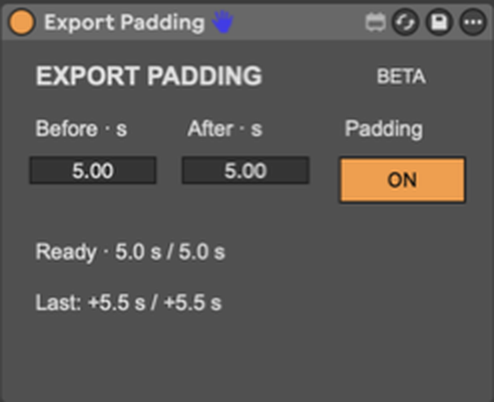

# Export Padding

Extra time around your Ableton Live exports, from a small Max for Live device.

Place Export Padding on Main, choose the time before and after your Arrangement
selection, and leave padding enabled. Open Live's normal Export Audio/Video
dialog; the device extends the render bounds to include the surrounding timeline
audio. Before and After use half-second steps. No companion application is required.

## Free beta

**[Download Export Padding 0.1.0 beta 1](https://github.com/mathewharwich/export-padding-releases/releases/tag/v0.1.0-beta.1)**

This repository distributes official Export Padding beta downloads and public
documentation. The source repository is private. Use of the official beta is
free for personal or professional work under the accompanying Export Padding
Beta License. Future releases may be paid products.

The development repository is private, and the device is distributed under a
proprietary license. Max for Live devices can be opened and inspected; packaging
is not encryption or copy protection.

Choose the **Export Padding ZIP** asset on the release page. GitHub's automatically
generated “Source code” archives contain only this repository's public
documentation and artwork; they do not contain the device or its proprietary
source code.

## Compatibility

- macOS and Ableton Live 12 with Max for Live; Live Suite includes Max for Live.
- Tested on Intel with Live 12 Suite 12.4.16. The native external is universal;
  native Apple silicon runtime testing is still pending.
- The current beta supports Live's English interface, constant tempo, 4/4 meter,
  and one enabled Export Padding instance per Set.
- Render adjustment uses Live's displayed sixteenth-note fields. Handles are
  not sample-accurate; hidden off-grid fractions can affect exact file length.
- Padding extends the timeline render. Nearby clips can therefore be audible in
  the added handles, and the start is clamped at the beginning of the Arrangement.

Read each release's installation and compatibility notes before installing.

## Install and use

1. Unzip the beta download.
2. Copy **Export Padding.amxd** into your Ableton User Library and drag it onto
   Main. The frozen device includes its dependencies; there is no separate app
   or external to install.
3. Choose Before and After in seconds, leave **Padding ON**, and select an
   Arrangement time range.
4. Open **Export Audio/Video**, wait for the adjusted bounds, check Render Start
   and Render Length, and export normally.

**Padding OFF** or bypassing the device leaves exports unchanged.

The embedded native external is Developer ID signed and notarized by Apple.
The ZIP and Max device are not separately notarized containers.

## Support and privacy

- [Product information](https://dev.mathewharwich.com/projects/export-padding)
- [Report a reproducible bug](https://github.com/mathewharwich/export-padding-releases/issues)

Include the device version, Live version, macOS version, computer architecture,
padding values, and clear steps to reproduce a problem. Do not post private Sets,
copyrighted audio, credentials, or unreviewed screenshots or diagnostics.

Export Padding runs inside Live. It does not require a companion app or account.

Export Padding is an independent project by Mathew Harwich, not affiliated with
or endorsed by Ableton or Cycling '74. Ableton Live and Max for Live are products
of their respective owners.
